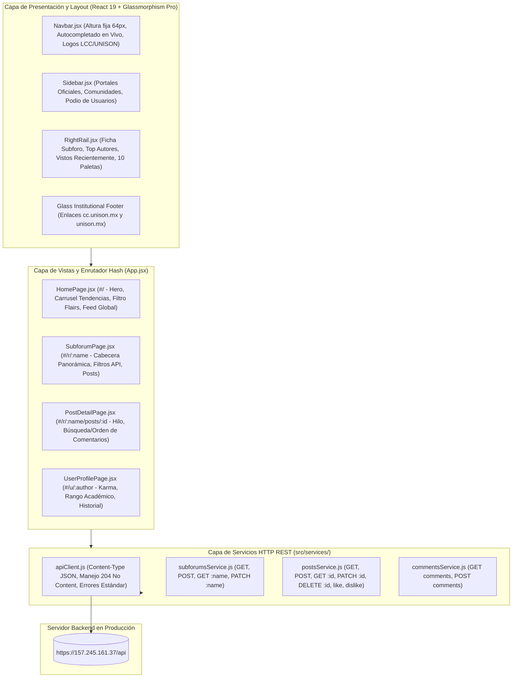

# Documentación Integral de Ingeniería de Software y Metodología por Sprints — Proyecto Final 2026 (`LCC-chan`)

**Institución:** Universidad de Sonora (UNISON) — [www.unison.mx](https://www.unison.mx/)  
**Programa Académico:** Licenciatura en Ciencias de la Computación (LCC) — [cc.unison.mx](https://cc.unison.mx/)  
**Proyecto:** `LCC-chan` — Plataforma Web de Foros de Discusión Comunitaria  
**Metodología Aplicada:** Marco Ágil **Scrum** + Desarrollo Incremental Basado en Componentes + Flujo **Git Feature-Branch**  
**Rama de Desarrollo Activa:** `carlos` *(manteniendo la rama `main` intacta)*  
**Servidor Backend API REST en Producción:** `https://157.245.161.37/api` (`https://157.245.161.37/api/subforums`)  
**Stack Tecnológico:** React `19.3.1` + Vite `8.3.8` + JavaScript (ES Modules) + CSS3 Custom Properties (Glassmorphism Pro, 10 Paletas)  
**Fecha de Documentación:** 26 de noviembre de 2026  

---

## Índice General

1. [Resumen Ejecutivo y Alcance del Sistema](#1-resumen-ejecutivo-y-alcance-del-sistema)
2. [Metodología de Desarrollo de Software (Agile Scrum + Git Workflow)](#2-metodología-de-desarrollo-de-software-agile-scrum--git-workflow)
3. [Ingeniería de Requisitos (Funcionales y No Funcionales)](#3-ingeniería-de-requisitos-funcionales-y-no-funcionales)
4. [Product Backlog e Historias de Usuario (User Stories)](#4-product-backlog-e-historias-de-usuario-user-stories)
5. [Bitácora de Ejecución por Sprints (Sprints 1 al 5)](#5-bitácora-de-ejecución-por-sprints-sprints-1-al-5)
6. [Arquitectura del Software y Estructura de Directorios](#6-arquitectura-del-software-y-estructura-de-directorios)
7. [Matriz de Cumplimiento 100% del Contrato API REST (`13 Endpoints`)](#7-matriz-de-cumplimiento-100-del-contrato-api-rest-13-endpoints)
8. [Sistema de Diseño Visual (Glassmorphism Pro, 10 Paletas e Identidad UNISON-LCC)](#8-sistema-de-diseño-visual-glassmorphism-pro-10-paletas-e-identidad-unison-lcc)
9. [Aseguramiento de Calidad (QA), Validaciones y Pruebas](#9-aseguramiento-de-calidad-qa-validaciones-y-pruebas)
10. [Manual de Despliegue en Producción con Vercel](#10-manual-de-despliegue-en-producción-con-vercel)

---

## 1. Resumen Ejecutivo y Alcance del Sistema

**LCC-chan** es una aplicación web *Single Page Application (SPA)* inspirada en la arquitectura comunitaria de **Reddit**, diseñada específicamente para la comunidad estudiantil y académica de la **Licenciatura en Ciencias de la Computación (LCC)** de la **Universidad de Sonora (UNISON)**.

El sistema opera bajo un modelo de **participación abierta sin cuentas ni contraseñas**: cualquier usuario puede crear comunidades temáticas (`r/subforo`), redactar publicaciones con código, texto e imágenes (`imageUrl`), reaccionar mediante votos positivos o negativos (`likes` / `dislikes`), participar en hilos de comentarios permanentes y consultar con un solo clic el perfil e historial completo de publicaciones de cualquier autor (`u/usuario`).

---

## 2. Metodología de Desarrollo de Software (Agile Scrum + Git Workflow)

Para garantizar entregas incrementales funcionales, trazabilidad técnica y cero regresiones, el desarrollo se estructuró aplicando el marco ágil **Scrum** adaptado a desarrollo web moderno junto con una estrategia de control de versiones **Git Feature-Branch**.

### 2.1. Artefactos y Ceremonias Aplicadas
1. **Product Backlog:** Lista priorizada de requisitos derivados de la especificación oficial `LCC-chan_api_documentacion (1).md` y de las mejoras de experiencia de usuario tipo Reddit.
2. **Sprints Iterativos (5 Sprints):** Ciclos cortos de construcción donde cada sprint entregó un incremento funcional verificado mediante análisis estático (`npm run lint`) y compilación de producción (`npm run build`).
3. **Definition of Done (DoD — Definición de Terminado):**
   - El componente o servicio consume directamente la API real en `https://157.245.161.37/api`.
   - Cumple las reglas de validación de campos y manejo de códigos HTTP (`200`, `201`, `204`, `400`, `404`, `409`, `500`).
   - Se adapta visualmente a las **10 paletas de colores** sin desplazamientos geométricos (*layout shifts*).
   - Pasa `oxlint` con **0 errores** y genera el bundle `dist/` sin fallos.
   - Queda registrado en esta documentación técnica dentro de la carpeta `sprints/`.

### 2.2. Estrategia de Ramas en Git (*Git Branching Model*)
- **`main`:** Rama troncal protegida con la configuración base inicial y la especificación de la API. No se modifica directamente durante el desarrollo.
- **`carlos`:** Rama activa de desarrollo e integración del Frontend completo documentado en este archivo.
- **`Joules`:** Rama paralela de trabajo del equipo.

---

## 3. Ingeniería de Requisitos (Funcionales y No Funcionales)

### 3.1. Requisitos Funcionales (`RF`)

| Código | Categoría | Descripción del Requisito Funcional | Estado |
| :---: | :--- | :--- | :---: |
| **RF-01** | Subforos | Listar subforos de forma paginada (`page`, `limit` 1–50) y ordenable por última actividad (`lastActivity`) o cantidad de posts (`postCount`) en orden `asc` o `desc`. | ✅ Cumplido |
| **RF-02** | Subforos | Crear nuevos subforos (`POST /subforums`) validando `name` (`3–40` caracteres, solo `a-z`, `0-9`, `-`, sin espacios) y `description` (`1–300` caracteres), manejando conflictos `409 Conflict`. | ✅ Cumplido |
| **RF-03** | Subforos | Consultar la ficha individual de un subforo (`GET /subforums/:name`) mostrando su contador de posts, fecha de creación y última actividad. | ✅ Cumplido |
| **RF-04** | Subforos | Editar exclusivamente la descripción de un subforo (`PATCH /subforums/:name`), impidiendo su eliminación o cambio de nombre. | ✅ Cumplido |
| **RF-05** | Posts | Listar publicaciones de un subforo (`GET /subforums/:name/posts`) con soporte completo de filtros: `page`, `limit`, `afterDate`, `beforeDate`, `hasImage`, `sortBy` (`date`, `author`, `contentLength`, `likes`, `dislikes`) y `order`. | ✅ Cumplido |
| **RF-06** | Posts | Crear publicaciones (`POST /subforums/:name/posts`) validando `title` (`1–150`), `content` (`1–5000`), `author` (`1–50`) e `imageUrl` opcional (`http://` o `https://`, o `null`). | ✅ Cumplido |
| **RF-07** | Posts | Respetar estrictamente la jerarquía visual de renderizado: **1° Título (`title`) → 2° Contenido en texto (`content`) → 3° Imagen al final (`imageUrl`)** con manejador `onError` y visor Lightbox. | ✅ Cumplido |
| **RF-08** | Posts | Editar parcialmente un post (`PATCH /subforums/:name/posts/:postId`) enviando únicamente `title`, `content` y/o `imageUrl`, sin enviar campos protegidos (`author`, `likes`, `dislikes`, etc.). | ✅ Cumplido |
| **RF-09** | Posts | Eliminar publicaciones (`DELETE /subforums/:name/posts/:postId`) procesando correctamente la respuesta vacía `204 No Content` sin invocar `response.json()`. | ✅ Cumplido |
| **RF-10** | Reacciones | Sumar `+1` like (`POST .../like`) y `+1` dislike (`POST .../dislike`) sin cuerpo JSON, actualizando los contadores en tiempo real con retroalimentación visual de partículas. | ✅ Cumplido |
| **RF-11** | Comentarios | Consultar (`GET .../comments`) y publicar comentarios (`POST .../comments`, `author` 1–50, `content` 1–1500) garantizando su inmutabilidad (sin edición ni borrado). | ✅ Cumplido |
| **RF-12** | Perfiles | Generar páginas de perfil individuales por usuario (`#/u/:author`) accesibles en 1 clic desde cualquier post, comentario o barra lateral, mostrando Karma, rango académico, comunidades donde participa e historial completo de publicaciones. | ✅ Cumplido |
| **RF-13** | Multimedia | Permitir adjuntar imágenes arrastrando y soltando archivos locales (*Drag & Drop*) o pegando del portapapeles, convirtiéndolas automáticamente en enlaces `https://...` compatibles con `imageUrl`. | ✅ Cumplido |
| **RF-14** | Búsqueda | Ofrecer autocompletado interactivo en vivo en la barra superior para buscar y seleccionar subforos (`r/`), usuarios (`u/`) y publicaciones con soporte de teclado (`↑↓`, `Tab`, `Enter`). | ✅ Cumplido |
| **RF-15** | Identidad | Integrar los emblemas oficiales en PNG transparente de **LCC** (redirigiendo a `https://cc.unison.mx/`) y de la **Universidad de Sonora** (redirigiendo a `https://www.unison.mx/`). | ✅ Cumplido |

### 3.2. Requisitos No Funcionales (`RNF`)

| Código | Atributo de Calidad | Descripción Técnica | Estado |
| :---: | :--- | :--- | :---: |
| **RNF-01** | Estabilidad Visual | La barra de navegación superior (`.glass-navbar`) mantiene una altura fija e inmutable de **`64px`** al alternar entre cualquiera de las **10 paletas de colores**. | ✅ Cumplido |
| **RNF-02** | Responsividad Móvil y Desktop | Diseño adaptable desde pantallas Ultra-Wide (3 columnas: `255px + 1fr + 310px` y Modo Teatro Ancho) hasta teléfonos móviles (`<= 860px` y `<= 580px`), incluyendo **Cajón Lateral Deslizante (*Slide-Over Drawer*)**, **Barra Inferior Táctil (*Mobile Bottom Dock*)**, **Buscador Móvil de 2 Filas con Autocompletado a pantalla completa** y **Carrusel Trending deslizable (*Touch Scroll-Snap*)**. | ✅ Cumplido |
| **RNF-03** | Rendimiento | Tiempo de compilación con Vite `< 600 ms`, carga diferida (`loading="lazy"`) en imágenes y transiciones aceleradas por GPU (`transform`, `opacity`). | ✅ Cumplido |
| **RNF-04** | Portabilidad Cloud | Enrutamiento basado en Hash (`#/`, `#/r/:name`, `#/r/:name/posts/:id`, `#/u/:author`) y archivo [vercel.json](file:///home/carlos/Documents/Proyecto-Final-2026/proyecto-final-2026/vercel.json) configurado con rewrites para despliegue directo en **Vercel** sin errores `404` al recargar. | ✅ Cumplido |

---

## 4. Product Backlog e Historias de Usuario (User Stories)

| ID | Historia de Usuario (Formato Estándar Ágil) | Criterio de Aceptación Principal (Given / When / Then) | Sprint |
| :---: | :--- | :--- | :---: |
| **HU-01** | **Como** estudiante de LCC, **quiero** explorar y crear subforos temáticos sin registrarme, **para** abrir espacios de discusión sobre materias y proyectos. | **Dado** el formulario de nuevo subforo, **cuando** ingreso un `name` válido (`a-z0-9-`) y `description`, **entonces** se envía `POST /subforums` y navego automáticamente a `r/:name`. | Sprint 1–2 |
| **HU-02** | **Como** usuario del foro, **quiero** publicar, editar y eliminar posts con texto, código e imágenes, **para** compartir dudas o recursos con la comunidad. | **Dado** un subforo activo, **cuando** publico o edito un post, **entonces** se respeta el orden `1° Título -> 2° Contenido -> 3° Imagen` y el `PATCH` omite campos protegidos. | Sprint 2 |
| **HU-03** | **Como** miembro de la comunidad, **quiero** hacer clic en el nombre de cualquier autor (`u/usuario`), **para** ver su perfil completo y todo su historial de publicaciones. | **Dado** cualquier chip `u/autor`, **cuando** hago clic sobre él, **entonces** se abre `#/u/:author` mostrando su Karma Neto, rango académico, comunidades y listado filtrable de posts. | Sprint 3 |
| **HU-04** | **Como** autor de una publicación, **quiero** arrastrar una imagen desde mi computadora y ver una vista previa en vivo antes de publicar, **para** subir contenido multimedia de forma rápida y segura. | **Dado** el área *Drag & Drop*, **cuando** suelto un archivo PNG/JPG/WEBP/GIF, **entonces** se genera automáticamente la URL externa `https://...` y puedo previsualizar el post en la pestaña `👁️ Vista Previa`. | Sprint 4–5 |
| **HU-05** | **Como** visitante, **quiero** que el buscador me sugiera subforos y usuarios mediante autocompletado mientras escribo y poder personalizar el tema entre 10 paletas, **para** navegar con fluidez y comodidad visual. | **Dado** el buscador superior, **cuando** enfoco o escribo texto (o `r/`, `u/`), **entonces** se despliega el autocompletado con coincidencias resaltadas y navegación por teclado (`↑↓`, `Tab`, `Enter`). | Sprint 5 |

---

## 5. Bitácora de Ejecución por Sprints (Sprints 1 al 5)

### Sprint 1: Inicialización, Flujo Git y Conexión Directa con Backend (`https://157.245.161.37/api`)
- Configuración de la rama `carlos` y creación de la guía de flujo Git en [explicacion_proceso_proyecto.md](file:///home/carlos/Documents/Proyecto-Final-2026/sprints/explicacion_proceso_proyecto.md).
- Enlace directo al servidor de producción en [.env](file:///home/carlos/Documents/Proyecto-Final-2026/proyecto-final-2026/.env), [.env.example](file:///home/carlos/Documents/Proyecto-Final-2026/proyecto-final-2026/.env.example), [storage.js](file:///home/carlos/Documents/Proyecto-Final-2026/proyecto-final-2026/src/utils/storage.js) y [apiClient.js](file:///home/carlos/Documents/Proyecto-Final-2026/proyecto-final-2026/src/services/apiClient.js).
- Implementación de los servicios [subforumsService.js](file:///home/carlos/Documents/Proyecto-Final-2026/proyecto-final-2026/src/services/subforumsService.js), [postsService.js](file:///home/carlos/Documents/Proyecto-Final-2026/proyecto-final-2026/src/services/postsService.js) y [commentsService.js](file:///home/carlos/Documents/Proyecto-Final-2026/proyecto-final-2026/src/services/commentsService.js).

### Sprint 2: Módulos Core CRUD, Validadores Estrictos y Reglas de Negocio
- Creación de [validators.js](file:///home/carlos/Documents/Proyecto-Final-2026/proyecto-final-2026/src/utils/validators.js) y [formatDate.js](file:///home/carlos/Documents/Proyecto-Final-2026/proyecto-final-2026/src/utils/formatDate.js).
- Implementación de componentes base ([Modal.jsx](file:///home/carlos/Documents/Proyecto-Final-2026/proyecto-final-2026/src/components/ui/Modal.jsx), [Pagination.jsx](file:///home/carlos/Documents/Proyecto-Final-2026/proyecto-final-2026/src/components/ui/Pagination.jsx), [ErrorAlert.jsx](file:///home/carlos/Documents/Proyecto-Final-2026/proyecto-final-2026/src/components/ui/ErrorAlert.jsx), [EmptyState.jsx](file:///home/carlos/Documents/Proyecto-Final-2026/proyecto-final-2026/src/components/ui/EmptyState.jsx)) y módulos de Subforos, Posts, Filtros y Comentarios.

### Sprint 3: Arquitectura Híbrida Reddit + Glassmorphism Pro de 3 Columnas y Perfiles de Usuario en 1 Clic
- Diseño de 3 columnas ([Navbar.jsx](file:///home/carlos/Documents/Proyecto-Final-2026/proyecto-final-2026/src/components/layout/Navbar.jsx), [Sidebar.jsx](file:///home/carlos/Documents/Proyecto-Final-2026/proyecto-final-2026/src/components/layout/Sidebar.jsx), [RightRail.jsx](file:///home/carlos/Documents/Proyecto-Final-2026/proyecto-final-2026/src/components/layout/RightRail.jsx)) con escenario multimedia de fondo desenfocado estilo Reddit.
- Creación de la vista de **Perfil e Historial de Usuario ([UserProfilePage.jsx](file:///home/carlos/Documents/Proyecto-Final-2026/proyecto-final-2026/src/pages/UserProfilePage.jsx)) en la ruta `#/u/:author`** con tarjetas KPI de Karma Neto, comunidades donde publica y filtros de historial.

### Sprint 4: Subida Multimedia Drag & Drop, Bloques de Código, Paleta `Ctrl+K`, Guardados y Animaciones
- Creación de [ImageDropzone.jsx](file:///home/carlos/Documents/Proyecto-Final-2026/proyecto-final-2026/src/components/ui/ImageDropzone.jsx) e [imageUploader.js](file:///home/carlos/Documents/Proyecto-Final-2026/proyecto-final-2026/src/utils/imageUploader.js) para arrastrar y soltar imágenes locales.
- Creación de [RichContentRenderer.jsx](file:///home/carlos/Documents/Proyecto-Final-2026/proyecto-final-2026/src/components/ui/RichContentRenderer.jsx) (bloques de código con copiado en 1 clic, menciones clicables `r/` y `u/` y enlaces externos) y [CommandPaletteModal.jsx](file:///home/carlos/Documents/Proyecto-Final-2026/proyecto-final-2026/src/components/ui/CommandPaletteModal.jsx) (`Ctrl+K`).
- Avatares generativos SVG (`<UserAvatar />`), banners panorámicos (`<CommunityBannerArt />`), explosión de partículas al votar (*Spark Burst*) y *Hover Preview Cards*.

### Sprint 5: Identidad Oficial UNISON & LCC, 10 Paletas, Barra Superior Inmutable, Autocompletado y Configuración para Vercel
- Procesamiento en PNG transparente del **Logo Oficial de LCC** ([public/lcc-logo.png](file:///home/carlos/Documents/Proyecto-Final-2026/proyecto-final-2026/public/lcc-logo.png) → https://cc.unison.mx/) y del **Escudo Oficial de la Universidad de Sonora** ([public/unison-logo.png](file:///home/carlos/Documents/Proyecto-Final-2026/proyecto-final-2026/public/unison-logo.png) → https://www.unison.mx/).
- Fijación de altura inmutable de **`64px`** en la barra superior y expansión a **10 paletas de colores** en [variables.css](file:///home/carlos/Documents/Proyecto-Final-2026/proyecto-final-2026/src/styles/variables.css).
- Autocompletado en vivo en la barra de búsqueda ([Navbar.jsx](file:///home/carlos/Documents/Proyecto-Final-2026/proyecto-final-2026/src/components/layout/Navbar.jsx)), Carrusel de Tendencias, Filtro por Flairs, Rangos Académicos (*Búho Legendario*, *Senior Dev LCC*, etc.), Vista Previa en Vivo (`✍️ Escribir` | `👁️ Vista Previa`), Historial de "Vistos Recientemente", Ordenamiento/Respuesta en Comentarios (`OP` badge + `↩ Responder`), Footer Institucional y configuración de [vercel.json](file:///home/carlos/Documents/Proyecto-Final-2026/proyecto-final-2026/vercel.json) para despliegue directo en **Vercel**.
- **Mejoras de Usabilidad Multi-Usuario y Móvil:**
  1. **Selector de Comunidad (`r/subforo`) dentro del Modal Global `+ Publicar`** ([PostFormModal.jsx](file:///home/carlos/Documents/Proyecto-Final-2026/proyecto-final-2026/src/components/posts/PostFormModal.jsx)) para elegir en qué subforo publicar desde cualquier parte del sitio.
  2. **Sincronización en Vivo Multi-Usuario (`🔄 Actualizar` + Auto-Refresh silencioso cada 25s)** en [HomePage.jsx](file:///home/carlos/Documents/Proyecto-Final-2026/proyecto-final-2026/src/pages/HomePage.jsx), [SubforumPage.jsx](file:///home/carlos/Documents/Proyecto-Final-2026/proyecto-final-2026/src/pages/SubforumPage.jsx), [PostDetailPage.jsx](file:///home/carlos/Documents/Proyecto-Final-2026/proyecto-final-2026/src/pages/PostDetailPage.jsx) y [App.jsx](file:///home/carlos/Documents/Proyecto-Final-2026/proyecto-final-2026/src/App.jsx).
  3. **Autoguardado de Borradores (*Auto-Draft Recovery*)** en [PostFormModal.jsx](file:///home/carlos/Documents/Proyecto-Final-2026/proyecto-final-2026/src/components/posts/PostFormModal.jsx) y [CommentForm.jsx](file:///home/carlos/Documents/Proyecto-Final-2026/proyecto-final-2026/src/components/comments/CommentForm.jsx) para no perder texto si el usuario cierra el modal por error.
  4. **Compresión y Optimización Automática en `<canvas>` para Fotos de Celular** ([imageUploader.js](file:///home/carlos/Documents/Proyecto-Final-2026/proyecto-final-2026/src/utils/imageUploader.js)) para subidas ultrarrápidas en redes móviles.
  5. **Colapsado Inteligente (`📖 Leer publicación completa ↓`)** en posts largos dentro del feed ([PostCard.jsx](file:///home/carlos/Documents/Proyecto-Final-2026/proyecto-final-2026/src/components/posts/PostCard.jsx)).
  6. **Paginación Progresiva (`Cargar más publicaciones ↓`)** en el feed global ([HomePage.jsx](file:///home/carlos/Documents/Proyecto-Final-2026/proyecto-final-2026/src/pages/HomePage.jsx)).

---

## 6. Arquitectura del Software y Estructura de Directorios

### 6.1. Diagrama de Arquitectura en Capas



### 6.2. Árbol Completo de Archivos del Proyecto

```text
Proyecto-Final-2026/
├── README.md                                    # Descripción general e instrucciones del repositorio
├── sprints/
│   ├── documentacion.md                         # Documentación integral y metodológica del proyecto
│   ├── documentacion_metodologia_sprints.md     # Copia espejo de respaldo metodológico por sprints
│   ├── explicacion_proceso_proyecto.md          # Guía inicial de proceso y comandos Git
│   └── explicacion_proceso_proyecto.pdf         # Versión PDF de la guía inicial
└── proyecto-final-2026/
    ├── .env                                     # VITE_API_URL=https://157.245.161.37/api
    ├── .env.example                             # Plantilla de variables de entorno
    ├── vercel.json                              # Configuración de rewrites y SPA routing para Vercel
    ├── index.html                               # Entrada HTML5 + Favicon oficial /lcc-logo.png
    ├── package.json                             # Scripts dev, build, lint, preview
    ├── vite.config.js                           # Configuración de Vite y middleware multimedia
    ├── public/
    │   ├── lcc-logo.png                         # Logo oficial LCC recortado en PNG transparente
    │   └── unison-logo.png                      # Escudo oficial UNISON recortado en PNG transparente
    └── src/
        ├── main.jsx                             # Punto de montaje de React 19
        ├── App.jsx                              # Enrutador Hash, Master Grid 3 Columnas, Modo Teatro y Footer
        ├── index.css                            # Reset y tipografía base
        ├── App.css                              # Importación modular de hojas de estilo
        ├── assets/
        │   ├── lcc-logo.png
        │   └── unison-logo.png
        ├── styles/
        │   ├── variables.css                    # Tokens globales inmutables + 10 Paletas de Colores
        │   ├── components.css                   # Estilos de 3 columnas, Autocompletado, Carrusel, Perfiles y Modales
        │   └── animations.css                   # Keyframes: Border Beam, Spark Burst, Aurora, Stagger y Orbes
        ├── utils/
        │   ├── formatDate.js                    # Formateador ISO 8601 UTC y tiempo relativo
        │   ├── imageUploader.js                 # Subida Drag & Drop a URL pública https://...
        │   ├── storage.js                       # Persistencia de tema, alias, favoritos, historial visto y rangos
        │   └── validators.js                    # Validaciones estrictas según contrato de la API
        ├── services/
        │   ├── apiClient.js                     # Cliente HTTP centralizado
        │   ├── subforumsService.js              # 4 endpoints de subforos
        │   ├── postsService.js                  # 7 endpoints de posts y reacciones
        │   └── commentsService.js               # 2 endpoints de comentarios
        ├── components/
        │   ├── layout/
        │   │   ├── Navbar.jsx                   # Barra superior 64px + Autocompletado en vivo + Selector 10 Paletas
        │   │   ├── Sidebar.jsx                  # Menú izquierdo + Tarjetas oficiales LCC y UNISON
        │   │   └── RightRail.jsx                # Columna derecha + Top Autores + Vistos Recientemente + Portales
        │   ├── subforums/
        │   │   ├── SubforumCard.jsx
        │   │   ├── SubforumHeader.jsx
        │   │   └── SubforumFormModal.jsx
        │   ├── posts/
        │   │   ├── PostCard.jsx                 # 1° Título -> 2° Contenido -> 3° Imagen + Flairs + Hover Card
        │   │   ├── PostFiltersBar.jsx           # Filtros completos de la API (hasImage, fechas, sortBy, order, limit)
        │   │   ├── PostFormModal.jsx            # Crear/Editar Post + Drag & Drop + Pestaña Vista Previa en Vivo
        │   │   ├── QuickPostComposer.jsx        # Publicador rápido inline en el muro
        │   │   └── ReactionButtons.jsx          # Votación con partículas Spark Burst y +1 flotante
        │   ├── comments/
        │   │   ├── CommentForm.jsx              # Formulario con Vista Previa en Vivo, emojis y mención rápida
        │   │   ├── CommentItem.jsx              # Comentario con insignia OP, avatar SVG y botón ↩ Responder
        │   │   └── CommentList.jsx              # Lista de comentarios filtrable y ordenable
        │   └── ui/
        │       ├── CommandPaletteModal.jsx      # Paleta rápida de comandos (Ctrl + K)
        │       ├── EmptyState.jsx
        │       ├── ErrorAlert.jsx
        │       ├── ForumIcons.jsx               # Logos oficiales LCC y UNISON, avatares SVG y banners generativos
        │       ├── ImageDropzone.jsx            # Zona interactiva Drag & Drop de imágenes
        │       ├── Modal.jsx
        │       ├── Pagination.jsx
        │       └── RichContentRenderer.jsx      # Renderizador de bloques de código, links y menciones r/ y u/
        └── pages/
            ├── HomePage.jsx
            ├── SubforumPage.jsx
            ├── PostDetailPage.jsx
            └── UserProfilePage.jsx
```

---

## 7. Matriz de Cumplimiento 100% del Contrato API REST (`13 Endpoints`)

| # | Método y Ruta | Servicio Frontend | Vista / Componente | Reglas Verificadas |
| :-: | :--- | :--- | :--- | :--- |
| **1** | `GET /subforums` | [subforumsService.js](file:///home/carlos/Documents/Proyecto-Final-2026/proyecto-final-2026/src/services/subforumsService.js) | [HomePage.jsx](file:///home/carlos/Documents/Proyecto-Final-2026/proyecto-final-2026/src/pages/HomePage.jsx) | Soporta `page`, `limit` (`1–50`), `sortBy` (`lastActivity` \| `postCount`) y `order` (`desc` \| `asc`). |
| **2** | `POST /subforums` | [subforumsService.js](file:///home/carlos/Documents/Proyecto-Final-2026/proyecto-final-2026/src/services/subforumsService.js) | [SubforumFormModal.jsx](file:///home/carlos/Documents/Proyecto-Final-2026/proyecto-final-2026/src/components/subforums/SubforumFormModal.jsx) | Valida `name` (`3–40` chars, `^[a-z0-9-]+$`) y `description` (`1–300` chars). Captura `409 Conflict`. |
| **3** | `GET /subforums/:name` | [subforumsService.js](file:///home/carlos/Documents/Proyecto-Final-2026/proyecto-final-2026/src/services/subforumsService.js) | [SubforumPage.jsx](file:///home/carlos/Documents/Proyecto-Final-2026/proyecto-final-2026/src/pages/SubforumPage.jsx) | Renderiza `name`, `description`, `postCount`, `createdAt` y `lastActivityAt`. |
| **4** | `PATCH /subforums/:name` | [subforumsService.js](file:///home/carlos/Documents/Proyecto-Final-2026/proyecto-final-2026/src/services/subforumsService.js) | [SubforumHeader.jsx](file:///home/carlos/Documents/Proyecto-Final-2026/proyecto-final-2026/src/components/subforums/SubforumHeader.jsx) | Envía exclusivamente `{ "description": "..." }`. No permite eliminar el subforo. |
| **5** | `GET /subforums/:name/posts` | [postsService.js](file:///home/carlos/Documents/Proyecto-Final-2026/proyecto-final-2026/src/services/postsService.js) | [PostFiltersBar.jsx](file:///home/carlos/Documents/Proyecto-Final-2026/proyecto-final-2026/src/components/posts/PostFiltersBar.jsx) | Soporta `page`, `limit`, `afterDate`, `beforeDate`, `hasImage`, `sortBy` (`date`, `author`, `contentLength`, `likes`, `dislikes`) y `order`. |
| **6** | `POST /subforums/:name/posts` | [postsService.js](file:///home/carlos/Documents/Proyecto-Final-2026/proyecto-final-2026/src/services/postsService.js) | [PostFormModal.jsx](file:///home/carlos/Documents/Proyecto-Final-2026/proyecto-final-2026/src/components/posts/PostFormModal.jsx) | Valida `title` (`1–150`), `content` (`1–5000`), `author` (`1–50`) e `imageUrl` (`http/https` o `null`). |
| **7** | `GET /subforums/:name/posts/:postId` | [postsService.js](file:///home/carlos/Documents/Proyecto-Final-2026/proyecto-final-2026/src/services/postsService.js) | [PostDetailPage.jsx](file:///home/carlos/Documents/Proyecto-Final-2026/proyecto-final-2026/src/pages/PostDetailPage.jsx) | Obtiene el detalle completo del post individual. |
| **8** | `PATCH /subforums/:name/posts/:postId` | [postsService.js](file:///home/carlos/Documents/Proyecto-Final-2026/proyecto-final-2026/src/services/postsService.js) | [PostFormModal.jsx](file:///home/carlos/Documents/Proyecto-Final-2026/proyecto-final-2026/src/components/posts/PostFormModal.jsx) | Envía solo campos editables (`title`, `content`, `imageUrl`) y bloquea `author` y contadores. |
| **9** | `DELETE /subforums/:name/posts/:postId` | [postsService.js](file:///home/carlos/Documents/Proyecto-Final-2026/proyecto-final-2026/src/services/postsService.js) | [apiClient.js](file:///home/carlos/Documents/Proyecto-Final-2026/proyecto-final-2026/src/services/apiClient.js) | Detecta `response.status === 204` y retorna `null` sin llamar a `response.json()`. |
| **10** | `POST .../posts/:postId/like` | [postsService.js](file:///home/carlos/Documents/Proyecto-Final-2026/proyecto-final-2026/src/services/postsService.js) | [ReactionButtons.jsx](file:///home/carlos/Documents/Proyecto-Final-2026/proyecto-final-2026/src/components/posts/ReactionButtons.jsx) | Petición `POST` sin cuerpo JSON; actualiza `{ id, likes, dislikes }`. |
| **11** | `POST .../posts/:postId/dislike` | [postsService.js](file:///home/carlos/Documents/Proyecto-Final-2026/proyecto-final-2026/src/services/postsService.js) | [ReactionButtons.jsx](file:///home/carlos/Documents/Proyecto-Final-2026/proyecto-final-2026/src/components/posts/ReactionButtons.jsx) | Petición `POST` sin cuerpo JSON; actualiza `{ id, likes, dislikes }`. |
| **12** | `GET .../posts/:postId/comments` | [commentsService.js](file:///home/carlos/Documents/Proyecto-Final-2026/proyecto-final-2026/src/services/commentsService.js) | [CommentList.jsx](file:///home/carlos/Documents/Proyecto-Final-2026/proyecto-final-2026/src/components/comments/CommentList.jsx) | Procesa el arreglo directo `[...]` en orden cronológico. |
| **13** | `POST .../posts/:postId/comments` | [commentsService.js](file:///home/carlos/Documents/Proyecto-Final-2026/proyecto-final-2026/src/services/commentsService.js) | [CommentForm.jsx](file:///home/carlos/Documents/Proyecto-Final-2026/proyecto-final-2026/src/components/comments/CommentForm.jsx) | Valida `author` (`1–50`) y `content` (`1–1500`); comentarios permanentes. |

---

## 8. Sistema de Diseño Visual (Glassmorphism Pro, 10 Paletas e Identidad UNISON-LCC)

### 8.1. Catálogo de 10 Paletas de Colores ([variables.css](file:///home/carlos/Documents/Proyecto-Final-2026/proyecto-final-2026/src/styles/variables.css))
1. **Tokyo Night** (`tokyo-night`) — Azul nocturno japonés con acentos índigo (`#7aa2f7`) y violeta (`#bb9af7`).
2. **LCC UNISON** (`lcc-unison`) — Tema institucional oficial con Azul Ciencias de la Computación (`#009fe3`) y Dorado UNISON (`#f5a800`).
3. **Reddit Glass** (`reddit-dark`) — Carbón oscuro oficial con naranja Reddit (`#ff4500`).
4. **Gruvbox Dark** (`gruvbox-dark`) — Retro cálido mate con ámbar (`#fe8019`) y dorado (`#fabd2f`).
5. **Catppuccin Mocha** (`catppuccin`) — Pastel nocturno suave con lavanda (`#cba6f7`).
6. **Dracula Pro** (`dracula`) — Púrpura vampírico (`#bd93f9`) y rosa neón (`#ff79c6`).
7. **Nord Polar** (`nord`) — Azul ártico escandinavo (`#88c0d0`).
8. **Cyberpunk 84** (`synthwave`) — Synthwave violeta oscuro con magenta neón (`#ff2a85`) y cian eléctrico (`#00f0ff`).
9. **Reddit Daylight** (`reddit-light`) — Tema claro de alto contraste.
10. **Gruvbox Paper** (`gruvbox-light`) — Papel crema cálido para sesiones de lectura largas.

### 8.2. Integración de Emblemas Oficiales en PNG Transparente
- **Logo Oficial de LCC ([public/lcc-logo.png](file:///home/carlos/Documents/Proyecto-Final-2026/proyecto-final-2026/public/lcc-logo.png)):** Fondo blanco eliminado al 100% mediante canal alfa suave y filtro adaptativo `--logo-filter` para destacar tanto la `C` azul como la `C` negra en cualquier tema. Redirige a https://cc.unison.mx/.
- **Escudo Oficial de la Universidad de Sonora ([public/unison-logo.png](file:///home/carlos/Documents/Proyecto-Final-2026/proyecto-final-2026/public/unison-logo.png)):** Esquinas blancas exteriores eliminadas mediante *flood-fill* perimetral conservando todos los detalles blancos internos (*"UNIVERSIDAD DE SONORA"*, *"TODO • LO • ILUMINAN"*, *"1942"*). Redirige a https://www.unison.mx/.

---

## 9. Aseguramiento de Calidad (QA), Validaciones y Pruebas

Se ejecutaron las siguientes verificaciones automatizadas en `/home/carlos/Documents/Proyecto-Final-2026/proyecto-final-2026`:

1. **Análisis Estático de Código (`npm run lint` con `oxlint`):**
   - **Resultado:** `0 errors` en los 37 archivos del código fuente.
2. **Compilación de Producción (`npm run build` con `vite build`):**
   - **Resultado:** `✓ built in 419ms`, generando `dist/index.html`, hojas CSS optimizadas y bundle JS minificado.
3. **Verificación de Conectividad y CORS contra `https://157.245.161.37/api/subforums`:**
   - **Resultado:** Respuesta `HTTP/2 200 OK`, certificado TLS válido vía Caddy y cabecera `access-control-allow-origin: *`.

---

## 10. Manual de Despliegue en Producción con Vercel

El proyecto ya cuenta con el archivo [proyecto-final-2026/vercel.json](file:///home/carlos/Documents/Proyecto-Final-2026/proyecto-final-2026/vercel.json) preconfigurado para manejar tanto las rutas de la SPA como el proxy de subida de imágenes en la nube de **Vercel**.

### 10.1. Opción A (Recomendada): Despliegue Automático en Vercel desde GitHub (Rama `carlos`)

1. **Subir los cambios actuales a la rama `carlos` en GitHub:**
   ```bash
   cd ~/Documents/Proyecto-Final-2026
   git checkout carlos
   git add .
   git commit -m "feat: version final LCC-chan y documentacion por sprints lista para Vercel"
   git push origin carlos
   ```
2. **Importar el proyecto en el Dashboard de Vercel (https://vercel.com/new):**
   - Inicia sesión en **Vercel** con tu cuenta de **GitHub**.
   - Haz clic en **"Add New..." → "Project"** e importa el repositorio **`Proyecto-Final-2026`**.
3. **Configurar el Directorio Raíz (*Root Directory*):**
   - En la pantalla de configuración de Vercel, junto a **Root Directory**, haz clic en **Edit** y selecciona la carpeta:
     ```text
     proyecto-final-2026
     ```
   - Vercel detectará automáticamente **Framework Preset: Vite** (`npm run build` y carpeta de salida `dist`).
4. **Variable de Entorno (*Environment Variables*):**
   - Agrega la variable:
     - **Key:** `VITE_API_URL`
     - **Value:** `https://157.245.161.37/api`
   *(Nota: Aunque no la agregues manualmente, el proyecto ya tiene `https://157.245.161.37/api` como valor por defecto en [storage.js](file:///home/carlos/Documents/Proyecto-Final-2026/proyecto-final-2026/src/utils/storage.js#L8), por lo que funcionará de inmediato).*
5. **Desplegar la rama `carlos`:**
   - Haz clic en **Deploy**.
   - Si tu rama por defecto en GitHub es `main` (que aún no hemos tocado), en Vercel ve a **Project Settings → Git → Production Branch**, cambia `main` por **`carlos`** y guarda, o bien abre directamente la URL de vista previa que Vercel genera automáticamente para la rama `carlos` (`https://proyecto-final-2026-git-carlos-....vercel.app`).

### 10.2. Opción B (Directa desde tu Terminal en 30 segundos sin pasar por configuración de ramas): Vercel CLI

Si quieres desplegar directamente tu carpeta local `proyecto-final-2026` a un link público de Vercel desde tu terminal ahora mismo:

```bash
cd ~/Documents/Proyecto-Final-2026/proyecto-final-2026
npx vercel --prod
```

- La primera vez te pedirá iniciar sesión en el navegador, responder `Y` a las preguntas por defecto (detecta automáticamente `Vite` y el archivo `vercel.json`) y en **20 segundos** te entregará en la terminal tu URL pública `https://proyecto-final-2026-xxxx.vercel.app` lista y conectada a `https://157.245.161.37/api`.
